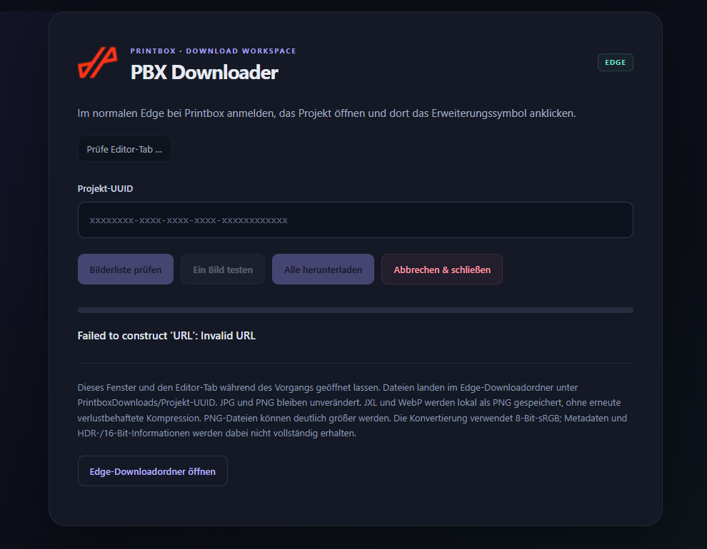

# PBX Downloader für Microsoft Edge

Projektbilder aus einem kompatiblen Printbox-Editor herunterladen – nach manuellem Login im normalen Browser, ohne Selenium oder Python. **Version 1.0.1.**

## Vorschau



Dark Mode mit Projekt-UUID, Bilderliste, Einzeltest, vollständigem Download und „Abbrechen & schließen“.

## Installation und Konfiguration

1. Repository klonen oder über **Code → Download ZIP** herunterladen und vollständig entpacken.
2. Im Ordner mit `manifest.json` die Datei `config.example.json` als **`config.local.json`** kopieren.
3. In dieser lokalen Datei die eigenen Instanzen eintragen:

```json
{
  "allowedOrigins": [
    "https://editor.example.com",
    "https://another-editor.example.com"
  ]
}
```

Die Beispieldomains ersetzen. Nur HTTPS-Ursprünge ohne Pfad, Query oder Zugangsdaten verwenden. **Die lokale Konfiguration ist von Git ausgeschlossen.** Keine Passwörter eintragen.

4. In Edge **`edge://extensions`** öffnen und **Entwicklermodus** aktivieren.
5. **Entpackte Erweiterung laden** wählen und den Ordner mit `manifest.json` auswählen.
6. PBX Downloader über das Erweiterungsmenü an die Symbolleiste anheften.

Den Ordner dauerhaft aufbewahren: Edge lädt die Erweiterung von dort. Python, Selenium, npm und ein Konvertierungsdienst sind zum Benutzen nicht erforderlich. Firmenrichtlinien können eine Installation durch die IT erfordern.

## Benutzung

1. Im normalen Edge an einer konfigurierten Instanz anmelden und ein eventuelles CAPTCHA manuell abschließen.
2. Ein berechtigtes Projekt unter `/editor/admin/PROJEKT-UUID/` öffnen und dort das Erweiterungssymbol anklicken.
3. Erkannte Projekt-UUID prüfen oder manuell eingeben.
4. **Bilderliste prüfen** wählen und bei Bedarf Zugriff auf die Instanz erlauben.
5. **Ein Bild testen** wählen, gegebenenfalls die angefragten Bildserver freigeben und die Datei prüfen.
6. **Alle herunterladen** verwenden.

Ziel: **`EDGE-DOWNLOADORDNER/PrintboxDownloads/PROJEKT-UUID/`**. Laufende Nummern vermeiden Namenskonflikte. Edge-Einstellungen oder Firmenrichtlinien können zusätzliche Speicherdialoge auslösen.

**Abbrechen & schließen** beendet Abruf, Konvertierung und laufenden Download und schließt den Downloader-Tab. Dasselbe gilt beim direkten Schließen dieses Tabs. Gespeicherte Dateien und der Edge-Downloadverlauf bleiben erhalten. Der Editor-Tab bleibt geöffnet. Keine automatische Wiederaufnahme.

## Bildformate und Grenzen

- JPG und PNG werden anhand der Dateisignatur erkannt und unverändert gespeichert.
- JXL und WebP werden lokal nach PNG konvertiert, ohne erneute verlustbehaftete JPEG-Kompression. PNG-Dateien können deutlich größer werden.
- Konvertierung: **8-Bit-sRGB**. Höhere Farbtiefe, HDR, Animationen, Profile und Metadaten bleiben nicht vollständig erhalten. Keine garantierte Rekonstruktion der ursprünglichen Upload-Datei.
- Maximal 150 MB Eingabedatei, 100 Megapixel Ausgabe und zwei Minuten je Abruf/Konvertierung. Pixelgrenze wird nach dem Dekodieren geprüft.
- API-Kompatibilität je Installation testen: Erwartet werden `/api/editor/photos/`, `results`, `offset`/`limit`, `X-Version: v6` und `X-Pbx-Store-Name: default_store`. Eine konfigurierte Domain allein garantiert keine Kompatibilität.
- Windows-Prozesse wie COM Surrogate werden nicht gestartet oder beendet. Edge verwaltet den Hintergrunddienst.

## Updates

1. Downloads beenden und den Downloader schließen.
2. Neue Git-Änderungen beziehen oder neues ZIP entpacken.
3. Bei ZIP-Ersetzung die eigene `config.local.json` vorher sichern und lokal übernehmen. Bei Git bleibt sie als ignorierte Datei erhalten.
4. Unter `edge://extensions` **Neu laden** wählen. Bei einem anderen Installationsordner die neue entpackte Version laden.
5. Aus dem Editor erneut öffnen und zuerst ein Bild testen. Änderungen an Berechtigungen können neue Edge-Abfragen auslösen.

Der [Versionsverlauf](CHANGELOG.md) dokumentiert auch die früheren Prototypen.

## Datenschutz und Veröffentlichung

Diese Kopie enthält keine produktiven Instanznamen, echten Projekt-UUIDs, eigenen Passwörter, Sitzungscookies oder API-Schlüssel. Beispiele sind künstlich. Produktname, App-Symbol und technische API-Pfade bleiben enthalten.

Die Erweiterung nutzt die Browsersitzung für Anfragen, ohne Cookie-Werte oder Passwörter auszulesen. Projekt-UUIDs, Bild-URLs und Dateinamen werden während der Benutzung verarbeitet. Temporärer Status liegt in `chrome.storage.session`; Dateien und Edge-Downloadverlauf bleiben lokal. Hostfreigaben bleiben bis zum Widerruf in Edge bestehen.

Keine Telemetrie und kein externer Konvertierungsdienst. Der Decoder wird mitgeliefert. Optionaler HTTPS-Hostzugriff erlaubt die Freigabe eigener Instanzen und ihrer Bildserver. Angefragt werden nur benötigte Ursprünge. `activeTab`/`scripting` dienen der Editor-Anbindung, `downloads` dem Speichern und Abbrechen, `storage` dem temporären Status.

**Nur den Inhalt dieser Kopie veröffentlichen.** `config.local.json`, echte Bilder, HAR-Dateien, Cookies und Logs nicht hochladen. `.gitignore` deckt typische lokale Dateien ab, entfernt aber keine bereits versionierten Dateien. Quellen und Lizenzen unter `vendor` beibehalten.

## Fehlerbehebung

- **Instanz nicht konfiguriert:** `config.local.json` prüfen, neu laden und aus dem HTTPS-Editor starten.
- **401/403 oder HTML statt JSON:** Login und Projektberechtigung prüfen. Die Erweiterung umgeht keine Schutzprüfung.
- **Bildabruf scheitert:** Hostfreigaben, Netzwerk und Edge-Fehler prüfen. Weiterleitungen können weitere Freigaben benötigen.
- **Speicherort unerwartet:** Edge-Downloadordner, Speicherdialoge und andere Download-Erweiterungen prüfen.
- Keine Cookies oder signierten Bild-URLs öffentlich teilen.

## Entwicklung und Tests

Node.js 22 oder neuer: Im Repository-Ordner **`npm test`** ausführen. Dafür ist kein `npm install` nötig. Tests prüfen API-Fehler, Dateiformate und -namen, JXL-Dekodierung sowie Downloadabbruch. Den vollständigen Ablauf zusätzlich in Edge testen.

Die Basisversion wurde praktisch verwendet. Die generische Konfiguration nach Eintragen eigener Instanzen erneut live testen.

Getestet und geprüft in Edge - mögliche Kompatibilität mit anderen Chromium Browsern.

## Mitgelieferte Bibliothek

JXL-Decoder: `@jsquash/jxl` 1.3.0. Herkunft: [vendor/NOTICE.md](vendor/NOTICE.md). [Apache-2.0-Lizenz](vendor/jxl/LICENSE). Öffentliche Autorenangaben der Bibliothek bleiben erhalten.
